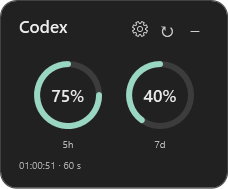

# Codex Limits Widget

A small, always-on-top Windows widget for your remaining Codex 5-hour and 7-day limits.

**Independent community utility. Not an official OpenAI application and not affiliated with or endorsed by OpenAI.** Beta software: compatibility with every Codex installation has not yet been verified.



## Features

- Display the 5-hour limit, the 7-day limit, or both.
- Standard progress bars or compact rings with percentages in the center.
- Ring depletion runs clockwise from twelve o'clock.
- Resize from any edge or corner; contents scale proportionally.
- Dark settings and notification-area controls.
- Refresh every 5, 10, 30, 60 or 120 seconds.
- Save display preferences, scale and window position locally.
- Hide to the system tray and reopen using the desktop shortcut.

## Requirements

- Windows 10 or 11 with Windows PowerShell 5.1 and .NET Framework/WPF.
- Codex for Windows, already signed in with **your own ChatGPT account**.
- Internet access for Codex to retrieve current quota information.
- Permission to run local PowerShell and Windows Script Host scripts. Organization policies may restrict these.

No Python, Node.js, paid API key or additional packages are required by the widget. It finds `codex.exe` on PATH or in the standard Codex desktop application's LocalAppData directory. npm-only installations exposing `codex.cmd` are not currently supported by automatic detection.

## Quick start

1. Download the project ZIP using **Code → Download ZIP**, or download a packaged release when available.
2. Extract the whole ZIP to a permanent, writable folder. Do not run it inside the archive.
3. Open **Install.vbs** to create the **Codex Limits** desktop shortcut and start the widget.
4. Alternatively, open **Start.vbs** to run without creating a shortcut.

Administrator rights are not needed. The launchers use a process-scoped PowerShell execution-policy override; they do not change the saved machine or user execution policy. Review downloaded scripts before running them. Managed Windows policies may still prevent startup.

If Windows Script Host is unavailable, run the widget from the extracted folder using Windows PowerShell:

```powershell
powershell.exe -NoProfile -STA -File .\Widget.ps1
```

## Controls

| Action | Control |
| --- | --- |
| Open settings | Gear button, or right-click tray icon → Settings |
| Refresh now | Circular arrow, or tray menu → Refresh |
| Hide | Minus button |
| Show again | Double-click tray icon or run the desktop shortcut again |
| Move | Drag the title area |
| Resize | Drag an edge or corner |
| See reset time in compact mode | Hover over a ring |
| Quit | Right-click tray icon → Exit |

The tray icon may be under the **^** menu near the clock. After moving the extracted folder, exit the widget and rerun **Install.vbs** to update the shortcut.

## Privacy and authentication

The widget starts the installed `codex app-server --stdio`, performs its initialization handshake and requests `account/rateLimits/read`. Codex owns authentication and contacts its service. The widget does not directly read `auth.json`, request an API key, collect chat history, or send analytics to a developer-operated server.

The Codex state directory is resolved from `CODEX_HOME`, or from `.codex` under the current Windows user's profile. This is a runtime path, **not a bundled account or authentication file**. Each person uses their own local Codex login. Standard API billing and general ChatGPT model limits are not shown.

Only these widget settings are written beside the application:

- `settings.json`: display mode, selected limits, refresh interval and scale.
- `position.json`: window coordinates, saved when exiting through the tray.

The source and release package do not contain authentication files, API keys, account IDs, real usage captures or chat history. Screenshots use synthetic test data. Never add `.codex`, `auth.json`, `.env`, real service-response logs or account exports to a shared copy.

Protocol reference: [Codex app-server documentation](https://learn.chatgpt.com/docs/app-server).

## How percentages work

Remaining percentage is `100 − usedPercent`, clamped to 0–100. Quota duration and reset timestamps come from Codex. Reset dates use the local Windows time zone. Display updates are snapshots, not a continuous prediction. On an error, old readings are retained with a message that fresh data is unavailable. Polling requests do not start model-generation tasks.

The 5-hour and 7-day filters match the durations returned by the service. If the selected duration is not provided for an account, the widget shows a missing-data message. Codex protocol or installation changes may require an update to this utility.

## Troubleshooting

- **Codex not found:** install/update Codex for Windows, or make its `codex.exe` available on PATH.
- **No usage data:** confirm that the same Windows user is signed in to Codex with ChatGPT, and check the connection.
- **Window hidden:** launch the shortcut again or double-click its tray icon.
- **Bad position:** exit through the tray, then remove only the widget's `position.json` before restarting.
- **Settings cannot be saved:** extract to a folder you can write to.
- **Script blocked:** review the source and follow your organization's policy; this application cannot override enforced policies.

## Development and verification

Source files are loaded directly by Windows PowerShell; no separate build toolchain is needed. Run offline layout checks without a Codex login:

```powershell
powershell.exe -NoProfile -STA -ExecutionPolicy Bypass -File .\Widget.ps1 -UiTest
```

Checks exercise six display/filter combinations, all five refresh intervals, ring boundaries, dark settings, three scales and all eight aspect-ratio resize directions. Generated previews go into ignored `work/`. These checks do not replace testing interactive resizing and Codex login on other Windows machines.

Create a portable package from an explicit list of application files:

```powershell
powershell.exe -NoProfile -File .\scripts\Package.ps1
```

## Uninstall

Choose **Exit** in the tray menu, then remove the desktop shortcut and extracted folder. Your Codex installation and login remain managed by Codex.

## License

MIT. See [LICENSE](LICENSE).
